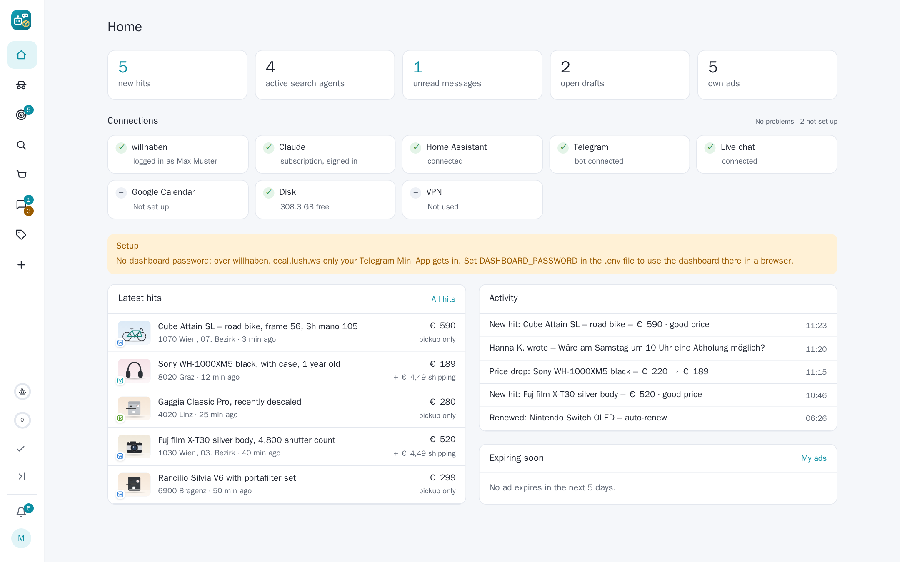
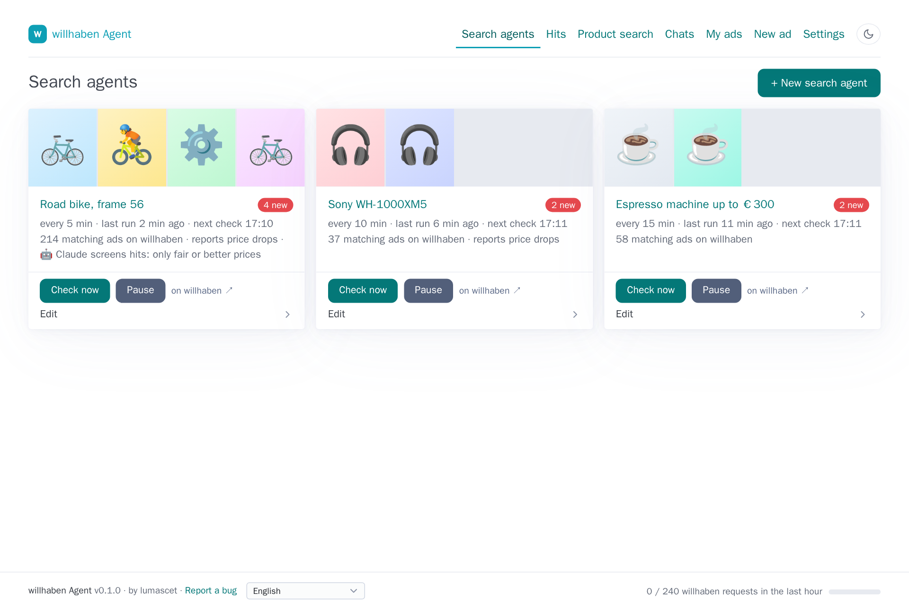
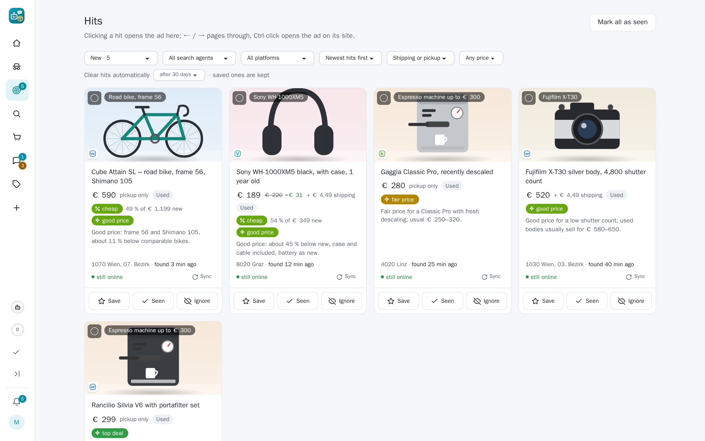
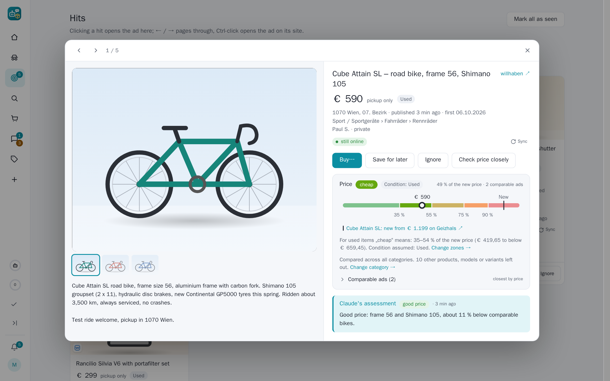
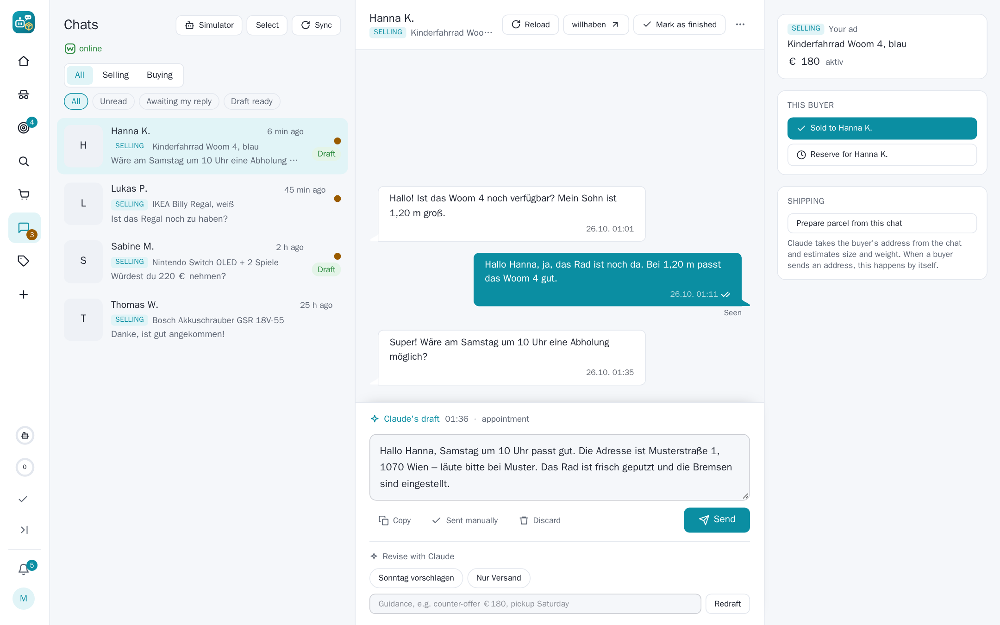
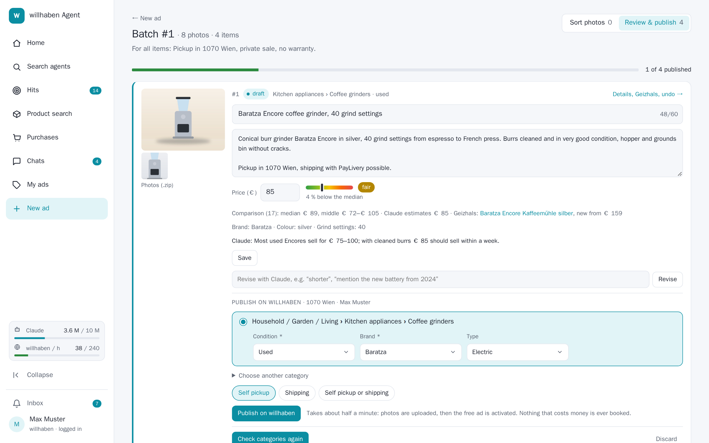
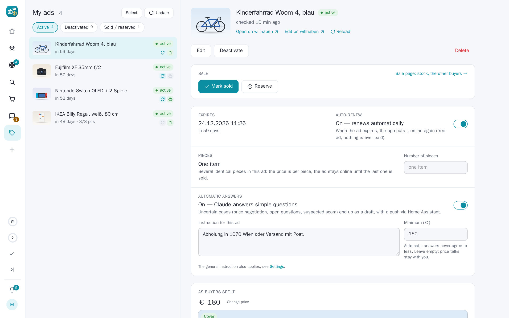

# willhaben Agent

> [!WARNING]
> **This tool was written entirely by AI (Claude).** It has been tested, but its correctness and safety cannot be
> guaranteed. You use it at your own risk and are responsible for everything it does in your name: it can send chat
> messages, publish, edit and delete ads on your willhaben account. Watch out for **prompt injection**: listings and
> chat messages from strangers end up in Claude's prompts, and a crafted text could try to steer an automatic reply or
> a screening verdict. Keep automatic replies limited to ads you are comfortable with and review what is sent.

A self-hosted assistant for [willhaben.at](https://www.willhaben.at), Austria's classifieds marketplace.
It runs on your own server, from your home internet connection, and you control it through a web dashboard
(English or German).

- **Search agents**: build a search with willhaben's own filters and get notified about new listings and
  price drops, usually much faster than willhaben's e-mail alerts. Hits open in a detail view inside the dashboard.
  Optionally Claude screens every new hit against a description of what you're looking for (right item? good deal?
  predefined reasons such as "accessory only" or "wrong variant"), and a rule-based scam check flags suspicious offers;
  only hits that pass reach your phone. Agents check at irregular, human-like intervals and slow down at night.
  A search agent can also be created from a finished product search: it then runs all of that search's keyword
  searches on every check and drops new ads over the plan's budget or with an exclusion word before they are stored.
- **Chats**: your willhaben conversations, synced live. Claude drafts replies in your style and nothing is sent
  until you click. For your own ads you can opt in to automatic answers to simple questions, with a minimum price
  Claude never goes below, human-like timing and read receipts; your 👍/👎 feedback goes into later answers.
- **Create ads quickly**: drop in notes and photos and Claude writes the title, description and category. You also get
  a price suggestion from comparable listings and the product's spec sheet from Geizhals. Upload photos of several
  items at once and Claude sorts them into one draft per item. Publish directly on willhaben (free private ads; the
  category comes from willhaben's suggestion or your own pick).
- **Product search** (tab "Produktsuche"): describe what you need (item, size, budget, condition, location) and
  Claude plans a few willhaben searches, the app runs them anonymously and Claude picks the best offers, each with a
  fit score, a short reason, red flags, the price bar and the scam check. An optional photo check (on by default)
  shows Claude the photos of the best offers (at most 10) and weighs damage, wear, wrong variants, stock photos or a
  different item against what you care about (a scratch barely counts if you prefer the lower price). When the
  description leaves something open (e.g. whether scratches are fine for a lower price), Claude may ask up to three
  short questions; the searches already run meanwhile, and the answers steer the ranking, the photo check and a
  search agent created from the search. Toggles for unusual names (misspellings, nicknames, generic descriptions) and other categories
  (mis-categorised ads, bundles) dig for hidden deals; the depth (≈3 / 6 / 12 searches) is the number of willhaben
  requests, Claude is called two or three times (plan, ranking, photo check).
- **Price check** (same tab): paste a willhaben link (or search by text) and see whether the price is cheap or expensive: a
  green-to-red bar against comparable listings of the **same kind of item** (same willhaben category, without accessories,
  other variants and extreme prices; you can pick another category), the Geizhals new price and, on click, Claude's verdict.
  Also in the hit viewer.
- **Your ads**: imported from your account, with a reminder before they expire. Per ad: auto-renew when it expires,
  edit text and photos (Claude can propose a better text), deactivate, delete, mark sold or reserved (other buyers get a
  notice draft).
- **Shipping**: when a buyer sends an address, the app compares parcel prices of Post, GLS, Hermes and DPD and shows
  the nearest drop-off points. The label is bought only after the buyer has paid: you mark the payment (a buyer's
  "I have paid" only becomes a reminder to check your account), then approve the purchase on the chat page or with a
  push button, or let the app buy automatically under your rules (ad marked sold to this buyer, confirmed parcel size,
  price cap, chosen carriers, a grace period to cancel, a daily limit). The purchase runs in the app's own browser with
  your stored payment card, a per-carrier playbook learned from the first run, code guards (price check, never
  insurance/newsletter/account changes) and a stop for bank confirmations. The label goes to a label printer
  (100×150 / 100×200 mm) or a normal printer over IPP, per carrier, with tray and crop settings; the carrier form in the
  remote browser stays as the manual fallback. One switch prints every label automatically (bought, downloaded from
  a carrier form, or from willhaben PayLivery), or none.
- **PayLivery**: willhaben's own notices in a chat (paid, label, shipped, delivered, payout, offers) are tracked for
  both roles, the willhaben label is downloaded (and printed when automatic printing is on), and each PayLivery step (accept or decline an offer, confirm receipt,
  buy or make an offer as a buyer, only with your confirmation) runs in the browser window with the API recording on,
  since willhaben's PayLivery calls are not documented yet.
- **Google Calendar** (optional): free times go into reply drafts, agreed appointments become calendar entries on a tap.
- **Notifications** through Home Assistant (events always, phone pushes with action buttons: send / revise with Claude /
  discard) and/or a **Telegram bot** with the same buttons, feedback buttons, commands and a typing indicator.
- **Connection watchdog**: tiles on the home page and a warning push when the willhaben login, Claude, Home Assistant,
  Telegram, live chat or disk space fails.
- **Polite by design**: every willhaben request goes through one shared rate limiter (minimum gap plus an
  hourly budget). Quiet hours slow the agents down at night. Nothing is ever written to willhaben without your approval.
- **MCP server**, so Claude Desktop or Claude Code can use the agent as a tool.

Claude runs through the Claude Code CLI with your Claude subscription. You don't need an API key.

## Screenshots

*Demo data – all names, ads and photos are made up.*

| | |
|---|---|
|  |  |
| **Home**: counters, connection watchdog, latest hits, activity | **Search agents**: built from willhaben's own filters, optional Claude screening |
|  |  |
| **Hits**: Claude's verdict and reason, price drops | **Ad viewer**: price bar against the same kind of item, Geizhals new price |
|  |  |
| **Chats**: Claude drafts the answer, you send it | **New ad**: Claude writes the listing, publish straight to willhaben |


**My ads**: auto-renew, automatic answers with a minimum price, deactivate / delete / mark sold.

## Quick start

Requirements: Docker with Compose, on a machine with a **home internet connection**. willhaben blocks
datacenter and VPN IP ranges.

```bash
mkdir willhaben-agent && cd willhaben-agent
curl -fsSLO https://raw.githubusercontent.com/lumascet/willhaben-agent/master/compose.yaml
docker compose up -d
```

This pulls the prebuilt image `ghcr.io/lumascet/willhaben-agent:latest`, which GitHub Actions builds from every push.
Update later with `docker compose pull && docker compose up -d`. To build from source instead, clone the repository and run
`docker compose up -d --build`. An optional `.env` next to `compose.yaml` (see `.env.example`) holds overrides such as
the dashboard password.

Open `http://<your-server>:8000` and finish the setup in the browser:

1. **Settings → willhaben account → Log in to willhaben.** The app runs its own Chromium. You see it right on
   the page and log in by clicking and typing into it. The session is stored in `data/` and survives restarts.
2. **Settings → Claude → Sign in with Claude.** Open the link, sign in with your Claude account and paste
   the code shown back into the page. The token is valid for a year and stored in `data/`.
3. **Settings → Home Assistant → Connect** (optional). Enter your Home Assistant address and log in. You're sent
   back automatically, and the app creates its own long-lived token in your HA profile. Pick the phone that should
   get pushes.
4. **Settings → Telegram** (optional): create a bot with @BotFather (`/newbot`), paste its token, tap "Link this chat"
   and press Start in Telegram. Settings → Chats decides whether pushes go to Home Assistant, Telegram or both.
5. **Search agents → New search agent.** Type what you're looking for, click filters, and create the agent.
   Optionally switch on "Claude screening" and describe exactly what you want.

Settings → Claude also shows the token usage per job and lets you pick a model per job (default: Opus for writing
listings, Sonnet for chat replies, screening and the product search).

The interface follows your browser's language (English or German). You can switch it in the footer or under
Settings → Language.

**Settings → Backup** downloads everything (database, tokens, ad photos, optionally the willhaben login) as one
ZIP, optionally encrypted with a passphrase, and restores such a file after a preview and a confirm click. The file
contains your logins: keep it private.

**willhaben requests:** the counter in the footer links to `/stats/willhaben`, a chart of every request the app
sent to willhaben in the last 1 h / 6 h / 24 h / 7 days (anonymous searches vs. the logged-in account vs. live chat,
blocked answers highlighted). Only counts per minute are stored (no addresses, ids or texts), for 8 days. Home
Assistant can read the same numbers from `GET /api/stats/willhaben?range=24h`. The footer leaves out failed live-chat reconnects, which
the rate limit does not pace; on the account channel a 403 ("blocked") is often just an expired login.

That's it. Setting a dashboard password is strongly recommended, because the app can send messages in your name
(`DASHBOARD_PASSWORD` in `.env`).

### Optional configuration (`.env`)

Every variable is optional. Values set in the dashboard win over the environment.

| Variable | Purpose |
|---|---|
| `DASHBOARD_PASSWORD`, `DASHBOARD_USER` | Login page for the dashboard (session cookie, optionally 30 days); API clients and the MCP server use HTTP basic auth with the same credentials (recommended) |
| `DASHBOARD_PORT` | Host port of the dashboard (default 8000) |
| `CLAUDE_CODE_OAUTH_TOKEN` | Claude token from `claude setup-token`, instead of signing in through the dashboard |
| `HA_URL`, `HA_TOKEN`, `HA_NOTIFY_SERVICE` | Home Assistant without the connect flow |
| `REQUEST_MIN_GAP_S`, `REQUESTS_PER_HOUR` | Rate limit for all willhaben requests (defaults 3 s, 240/h) |
| `DEFAULT_AGENT_INTERVAL_S`, `MIN_AGENT_INTERVAL_S`, `CHAT_POLL_INTERVAL_S` | Polling intervals |
| `VNC_PASSWORD`, `NOVNC_URL` | Optional noVNC view of the login browser (port 6080, LAN only) |
| `PROXY_VIA`, `PROXY_HOSTS` | Map hostnames (e.g. your HA domain) to a reverse-proxy container on a shared network |

See `.env.example` for all of them. Host-specific compose additions (extra networks, proxy settings) belong in
a `compose.override.yaml`. Compose merges it automatically, and it is git-ignored.

### Reporting a bug

The footer link **Report a bug** opens a page where you describe what happened and click **Create report**. The app
builds an anonymised report from its own state: version, connection states, counts, recent warnings and errors
(with tracebacks) and, optionally, harmless settings. Tokens, passwords, e-mail addresses, phone numbers, IP addresses,
your server's host names (including other subdomains of your domain), people's names, carrier logins, chat
messages, addresses, ad titles (also from willhaben URLs) are removed, and ids become placeholders such as `ad#1`. Creating it costs no willhaben or Claude request, and the app never sends it anywhere: copy it or download
it as `.txt`/`.json` and share it yourself. Read it before sharing.

## Home Assistant

The app fires events on the HA event bus: `willhaben_hit`, `willhaben_price_drop`, `willhaben_message`,
`willhaben_auto_reply`, `willhaben_auto_reply_pending`, `willhaben_ad_expiring`, `willhaben_ad_expired`,
`willhaben_ad_renewed`, `willhaben_meetup`, `willhaben_shipping`, `willhaben_health`, `willhaben_test`. The payload has
`title`, `message`, `url` and `image`, plus `agent`, `ad_id`, `price` or `conversation_id` depending on the event.
Hits also carry the screening result (`screen_relevant`, `screen_deal`, `screen_reason`, `screen_issues`) and the scam
check (`scam_flags`, `scam_level`). Events always fire, even for hits the screening holds back from your phone. If you picked a phone in
Settings, the app also sends pushes directly. Otherwise you can build your own automation:

```yaml
alias: willhaben hits to my phone
triggers:
  - trigger: event
    event_type: willhaben_hit
  - trigger: event
    event_type: willhaben_message
actions:
  - action: notify.mobile_app_YOUR_PHONE
    data:
      title: "{{ trigger.event.data.title }}"
      message: "{{ trigger.event.data.message }}"
      data:
        image: "{{ trigger.event.data.image }}"
        clickAction: "{{ trigger.event.data.url }}"
        url: "{{ trigger.event.data.url }}"
```

## MCP (Claude Desktop / Claude Code)

The MCP server is a thin client of the agent's JSON API and can run on your PC:

```bash
claude mcp add willhaben -e WH_AGENT_URL=http://<your-server>:8000 -e WH_AGENT_PASSWORD=... \
  -- uv --directory <path-to-repo> run python -m app.mcp_server
```

Claude Desktop (`claude_desktop_config.json`):

```json
{
  "mcpServers": {
    "willhaben": {
      "command": "uv",
      "args": ["--directory", "<path-to-repo>", "run", "python", "-m", "app.mcp_server"],
      "env": {"WH_AGENT_URL": "http://<your-server>:8000", "WH_AGENT_PASSWORD": "..."}
    }
  }
}
```

Tools: `status`, `search_willhaben`, `get_ad`, `list_search_agents`, `create_search_agent`, `list_hits`,
`list_conversations`, `get_conversation`, `draft_reply`, `save_reply_draft`, `send_reply`, `list_my_ads`,
`track_my_ad`.

## Status

| Feature | Status |
|---|---|
| Search agents, hits, price drops, quiet hours, human pace | done |
| Claude screening of hits (with reasons), scam check | done (thresholds still being tuned on real hits) |
| willhaben login in the dashboard, session check, silent re-login | done |
| Chat sync (live), history, Claude reply drafts, sending, read receipts | done |
| Automatic replies (opt-in per ad, limits, minimum price, feedback) | done |
| Own ads: import, expiry reminders, deactivate, delete | done |
| Own ads: auto-renew (activate / republish) | built from willhaben's web app; the first real renewal is still to be observed |
| Own ads: edit text and photos, sold / reserved | built; saving is **not yet live-tested** |
| Ad drafts with Claude, comparable prices, Geizhals specs, batch upload | done |
| Publishing ads directly | done for free private ads with pickup (batch cards and single draft page, category picker); shipping/PayLivery built from the bundle but **not yet live-tested** |
| Price check and product search (Produktsuche) | done (comparables from the same category, category selectable) |
| Home Assistant events, pushes with action buttons | done |
| Telegram bot, Google Calendar, parcel labels | built and tested with fakes; **not yet live-tested** |
| Paid status, label purchase approval and auto rules, label purchase in the browser, printing over IPP | built and tested with fakes and a fake IPP printer; **no live carrier checkout or real printer yet** |
| PayLivery notices and process (both roles) | built from the chat message types only; notice wording, label links and every action **unverified** – record them once (Settings → willhaben account → Advanced → API recording) |
| Connection watchdog, backup, bug report, request statistics | done |
| MCP server | done |

willhaben's interfaces used by the app are documented in `docs/willhaben-api.md`. To check a response shape, the
dashboard can record the built-in browser's requests (Settings → willhaben account → Advanced → API recording).

## Development

```bash
uv sync
uv run playwright install chromium
uv run pytest            # on a server without a matching venv: scripts/test.sh (tests + lint in the app image)
uv run python -m app
```

Locally a real Chromium window opens for the login. Use `BROWSER_HEADLESS=1` for headless mode and
`BROWSER_ENABLED=0` to run without a browser. Set `CLAUDE_BIN` if `claude` isn't on your PATH.

- **Languages**: source strings are English. German lives in `app/i18n/de/*.json`. Use `t("…")` in Python and
  `{{ _("…") }}` in templates. `tests/test_i18n.py` fails if a German translation is missing. Prompts for Claude stay
  German on purpose, since Claude writes Austrian German ads and replies.
- **Fixtures** are real willhaben responses. Redact new recordings before committing them:
  `python tests/redact_fixture.py tests/fixtures/<file>.json`. Never commit `data/`, `.env` or `compose.override.yaml`.
- **CI**: `.github/workflows/docker.yml` runs lint and tests, then builds the image and pushes it to GitHub
  Container Registry. The default branch gets `latest`, tags `v1.2.3` get `1.2.3` and `1.2`, and every build gets
  `sha-<commit>`. Pull requests build without pushing. To release, bump `app/__init__.py` and `pyproject.toml` and
  push a `vX.Y.Z` tag.

How the app talks to willhaben (endpoints, verification status) is documented in `docs/willhaben-api.md`.

## Account separation (search agents never use your login)

Everything that only **reads** willhaben runs as an **anonymous visitor**, completely separate from your
willhaben account: search agents, the Claude screening of hits, the product search and price check (Produktsuche), the scam check
and the ad viewer. They use their own HTTP client (`app/willhaben/public.py`, `PublicClient`) with its own cookie
jar — never the cookies of the logged-in browser. That anonymous session is replaced by a fresh one every
6 hours and immediately after willhaben blocks a request (403/429), so a blocked or rate-limited search does
not touch your account. A test (`tests/test_anonymous_public.py`) fails if any of these modules imports the
logged-in session.

Only actions that need your account go through the logged-in browser (`app/willhaben/session.py`): chats and
replies, "Meine Anzeigen", publishing, reserving/sold, reactivating. Each of these happens on your click or for
ads where you switched automation on.

What is still shared: the **home IP address** (unavoidable without a proxy) — which is why *all* willhaben requests,
anonymous and logged-in, go through one rate limiter with a minimum gap and an hourly budget, and back off on 403/429.

## Risks

- willhaben's robots.txt and terms forbid automated access. The app polls sparingly, serializes every request,
  backs off exponentially on 403/429 and never writes anything without your click (or your per-ad opt-in).
  Your account can still be suspended. Use at your own risk.
- willhaben's internal endpoints change without notice. Errors show up per search agent in the dashboard, and the
  parser tests use real (redacted) responses.
- `claude -p` with a subscription token is meant for personal use. The CLI version is pinned in the Dockerfile,
  because Anthropic has announced `--bare` (which ignores the token) as a future default.

---

willhaben Agent is an independent project by lumascet and is not affiliated with willhaben.
