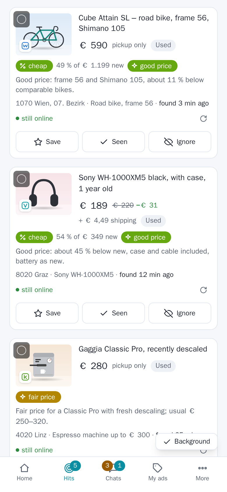
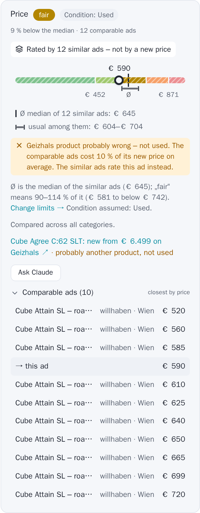
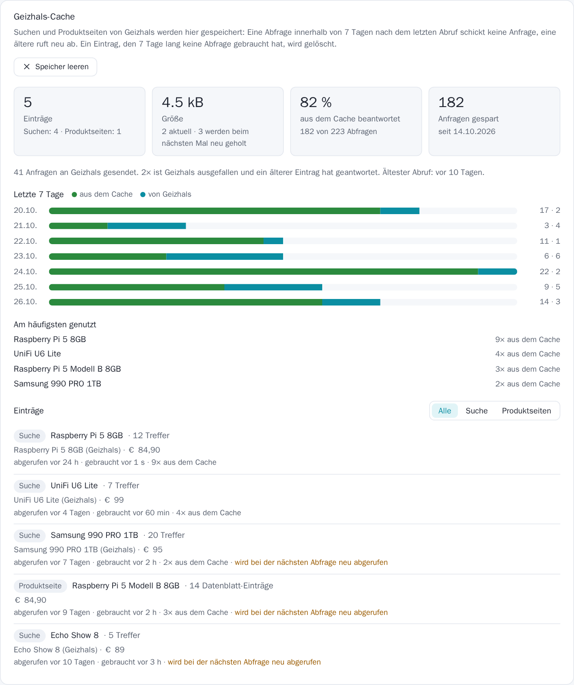

## SecondHandler 0.5.2

A release about trust and speed: an audit of the whole app (security, auto-buy, chats, product search), Claude
correcting wrong Geizhals products, a price rating by similar ads with limits you set, new prices for self-built
PCs, a product search that can spread a site's searches over several VPN servers, and hit cards that are easier to
read.

### Hit cards, redone

- **Every ad shows its site** – a coloured mark in the corner of the photo (willhaben, Kleinanzeigen, Vinted, Shpock,
  eBay, Preisjäger, Facebook), on the hit cards, the home page and the product search.
- **A calmer card**, worked out on cards with every label at once: the ratings in one row, each a pill with its
  source's icon (% for the Geizhals new price, the sparkle for Claude); a price drop reads "€ 31 −€ 6"; place,
  distance, dealer and time in one line; "still online" a small green dot.
- **On phones** only title and price sit beside the photo, everything else uses the card's full width.

### Geizhals new prices you can trust

- **Claude corrects a wrong product.** "Check price closely" now also tells whether the Geizhals product is the ad's.
  When it is another one – a "NUC 16 go ram" ad matched to the new ASUS NUC 16 – its price is dropped, the product
  Claude names is looked up instead and the price bar is placed again; the hit keeps it, and the wrong one does not
  come back.
- **Self-built PCs and sets** are priced as the sum of their parts (processor, graphics card, RAM, SSD, monitor …),
  each listed with its new price. A part never takes a whole PC's price, and with fewer than half the parts priced
  there is no total.
- **Graphics card variants count:** "RX 6600" no longer matches the dearer "RX 6600 XT" (XT, XTX, Ti, Super).
- **Product search:** Claude names each offer's product while ranking; "Discount" can always be pressed and says why
  when there is nothing to sort (e.g. every offer with a new price is above the search's Geizhals limit).

### Rated by similar ads – with your limits

- **A bar of its own** when there is no Geizhals new price, when the similar ads contradict it (probably another
  product) or for a used item with 5 or more comparable ads: striped zones, the median (Ø) as a dashed line, the
  limits in euros, and a line above it: "Rated by 12 similar ads – not by a new price".
- **You set what counts as cheap, fair or expensive:** Settings → Price rating → Similar ads, as a share of their
  median (default 70 / 90 / 115 / 135 %). It replaces the fixed rule "the middle half is fair"; the buy dialog,
  the product-search badges and the Mini App use the same limits.
- **A doubtful Geizhals product is said plainly:** a warning that it is not used, and its link reads "probably
  another product, not used".
- **Fewer wrong products in the first place:** "M.2", "Gen4", "2280" and the like are no model numbers any more
  (an "SSD NVMe M.2 … 512 Go" ad was matched to a 1 TB SSD of another brand); a product found automatically is
  dropped when its storage size or brand does not fit the ad; when an agent's check found no fitting product, the
  price check does not look one up by itself.

### Similar ads chosen by Claude

- **Claude names the product and the variant that sets the price** (generation, size, model number, fold count)
  and writes the searches; after them it picks the ads that are this product and variant, sold alone. Before, rules
  guessed from the title's words: an "EliteDesk 800 G6" was compared with G2 and G3 ads, a HomePod mini was searched
  as its colour. The rules stay the fallback; Settings → Price rating → "Similar ads chosen by Claude".
- **Sold or taken down recently**: a quiet hourly check reads the ads of recent hits; the price check shows what the
  agents' hits of this product went for (their last price), apart from the asking prices.
- **Agents' price range for hits without a new price**: judged by their similar ads first, then Claude's verdict.
- **Your own ads** (My ads): the price check of the ad, with the seller's view – where "fair" lies and what sells
  faster.
- **Buying**: the "cheap" suggestion is where the fair range starts; a draft to a seller knows the rating.

### Who you deal with

- **Young accounts and accounts without ratings are flagged**: under 90 days old (red under 30), or not a single
  rating. willhaben: the sign-up date from the ad, the PayLivery ratings and usual reply time from the public
  profile; Vinted: the seller's ratings; eBay: "member since" and the rating count. In the ad viewer under the
  seller, and in a chat next to the other person's online state (read once, again after a week).
- **Auto-buy only from trustworthy accounts** (Settings → Purchases, on): no automatic purchase from an account
  younger than 90 days or without a PayLivery rating.
- **The same photo in another ad**: re-listed ads are marked, a photo from another site or place (a classic scam
  pattern) is a warning; manufacturer pictures many sellers use are left alone.

### Price check, faster and more helpful

- **The bar shows at once**: the Geizhals new price is drawn while the comparable ads are still loading.
- **Slow sites rest**: a site that failed is not asked again within the same check, and one that did not answer in
  time is left out for 2 minutes; the price box names the sites left out.
- **"Price the components on Geizhals"**: Claude names the parts of a device sold whole (a mini PC's barebone, RAM,
  SSD …) and the new prices are summed.

- **Geizhals cache page with figures**: entries, size, the share of lookups answered from the cache, requests saved,
  the last 7 days, the most used entries, and the list filtered by kind.

### Faster product search

- **"Discount" always sorts**: when every offer with a new price is above your Geizhals limit, they are sorted into
  the list (marked) instead of a note that there is nothing to sort.

- **Several VPN servers per site** (Settings → VPN → Parallel, 1–8, off by default): a site's searches spread over
  that many servers, each paced on its own; extra servers start for the search and stop after 5 idle minutes; a
  server a site refuses drops out. Only for sites with their VPN switch on.
- Claude ranks up to **5 batches at once** (was 3); the shipping prices of the best offers load per site in parallel.
- Opening an older search looks its new prices up **without blocking** new searches.

### Safer auto-buy

- No purchase **on a guess**: a hit Claude did not judge, or one without a checked Geizhals price under a Geizhals
  limit, is not bought; nothing while purchases are switched off.
- **One at a time** per agent, the switch goes off after a purchase, a cancelled ad is not bought again.
- A successful buy is recognised at once (it ended as "paused" before); a cancel during the payment is honoured
  right before the pay click.

### Security

- The Telegram Mini App only listens to Telegram's own frame (another page could press its main button before).
- State-changing requests from another site are refused (CSRF), with or without a password.
- **Without a dashboard password** the public web address needs the Telegram login; the home network stays open.
- The Mini App stays logged in on **Telegram Web** in a desktop browser.

### Also

- **Weekly summary** on Mondays at 8 (Settings → Chats).
- **Kleinanzeigen and Vinted stay logged in** across updates of the app (their session cookies are kept).
- Home counts what the lists show: own ads that are online, expired ads of the last 30 days (the My-ads
  setting), chats with a draft and unread messages as in the chat list; the tiles open the matching filter.
- The ad viewer has a **Back** button after you open one of the comparable ads from the price check.
- A willhaben notice that turns unread again (e.g. "item shipped") is no longer pushed as a message from the buyer,
  no answer is drafted for it, and the chat's "1" no longer comes back after opening it.
- Chats: "Send + PayLivery" says honestly that neither can be taken back; a revise never offers a second answer
  after a send; deleting a renewed ad's old copy keeps its sales and chats together.
- Counters show what the list shows (pickup radius), saved hits are never hidden by distance; Claude's reason is
  kept on cleared hits; "1 comparable ad" instead of "1 comparable ads".
- README with new screenshots, made by `scripts/demo_screenshots.py` from made-up data.

### Upgrading

Nothing to do: new database fields are added at start; Pillow is a new dependency of the image. Log in to
Kleinanzeigen once more after the update – from then on the login is kept. Ads without a new price are now rated by your limits for
similar ads; check them once under Settings → Price rating. To try the parallel search, set Settings → VPN → Parallel
to 3 and run a product search.
