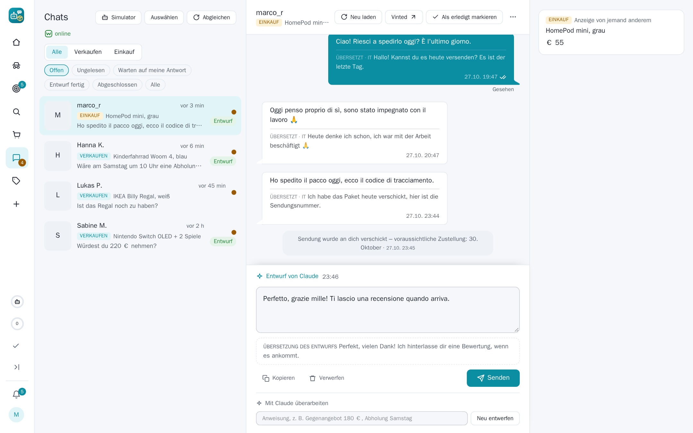
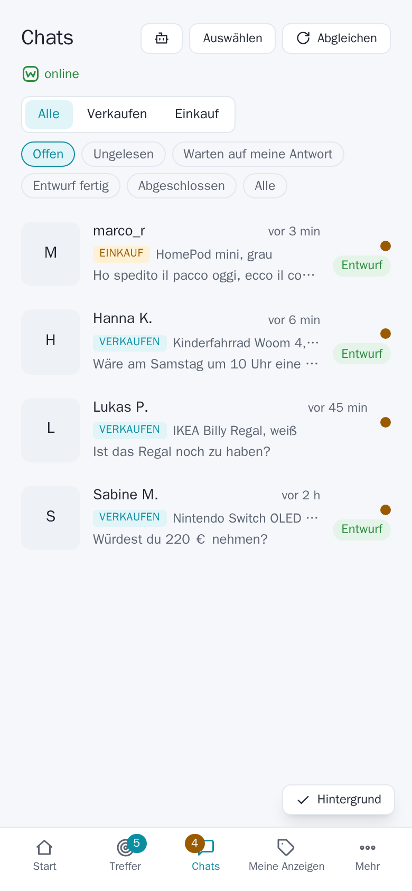

## SecondHandler 0.5.3

A release about chats across languages and sites: messages in another language come with a translation, Claude
answers in the other person's own language, finished conversations step aside, Vinted's messages and shipping
updates arrive as pushes – and a PayLivery sale of one piece puts the ad online again.

### Chats in every language

- **The original and the translation in one bubble**: a message in another language than the app's shows Claude's
  translation under it, marked with the language – on the dashboard and in the Mini App. Each message is asked once,
  in the background when the chat is opened (Settings → Chats → "Translate foreign messages").
- **Claude answers in the other person's language**: the language their messages are in, else their country's,
  else the one they last wrote – never the language of the site's notices. A draft in another language shows its
  translation for you below it.
- **Vinted's own translation is not the original**: where Vinted delivers the original beside its machine
  translation, the app keeps the original (the field names it sends are now logged, to find it).

### Finished chats step aside

- **The list shows the open chats** by default; "Finished" and "All" show the others, a finished chat carries a mark.
- **Finished by themselves**: a notice that the package was delivered or the deal is complete (Vinted, PayLivery),
  or Claude's look every half hour at chats with something new – a deal done, cancelled, or a goodbye with nothing
  open (Settings → Chats → "Mark finished chats automatically"). A new message opens the chat again.

### Vinted: messages and parcels on time

- **A new Vinted message is pushed** – before, the live event stored it first and no push ever went out.
- **Shipping updates are read and pushed**: an order's chat is read again every 30 minutes (its updates do not change
  the inbox), a chat page that does not answer gets a second try, each new order event ("shipped", "delivered") is
  pushed once.

### PayLivery: one piece sold, the ad goes online again

- A piece of an ad with several pieces bought with PayLivery is **recorded by itself**; a cancelled purchase gives it
  back. willhaben takes the ad offline after such a sale: with pieces left the app puts it online again – in place
  when willhaben offers it, otherwise as a new ad copied from it (title, text, price, category, photos, shipping and
  PayLivery option) – and sends a push. Reserved ads and ads you took offline yourself are left alone.
  Contributed in [#25](https://github.com/lumascet/SecondHandler/pull/25); **not yet tried against a real PayLivery
  sale** – watch the first one.

### Telegram Mini App

- **The Send button comes with the draft**: while Claude wrote, the page reloaded only its lower part and Telegram's
  Send button stayed off once the draft came – "Sent manually", which sends nothing, looked like the way to send.
  The composer declares the button now, and "Sent manually" is gone (on the dashboard too).

### Lighter browser

- **Vinted's live tab loads no ads**: its inbox page carried ad frames (Amazon, Criteo …), each a Chrome process of
  its own – most of the browser's memory. The idle remote view parks every page it shows and closes stray tabs;
  working pages (API, live chat, Vinted's live tab) stay.
- The hourly status check of recent hits leaves Facebook alone (its ad pages tripped Facebook's login block).

### Upgrading

Nothing to do: new database fields are added at start. Translations and the finished-chat check use Claude
(Settings → Claude, purpose "Chat replies"); both can be switched off under Settings → Chats.
